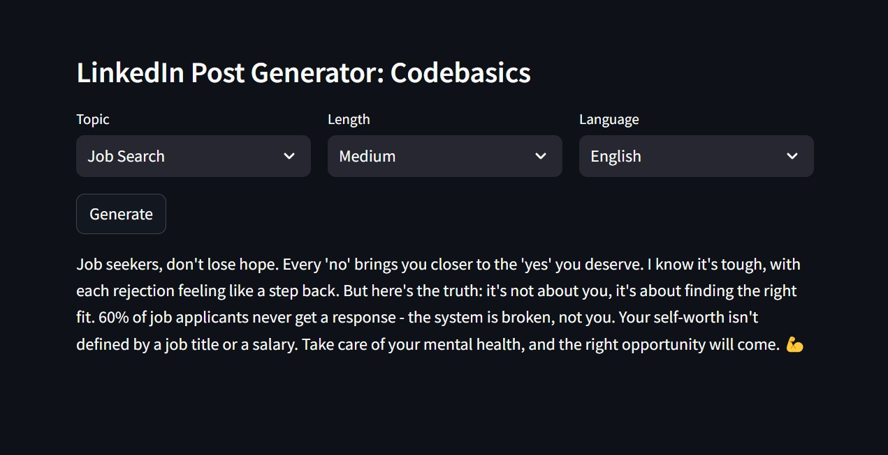
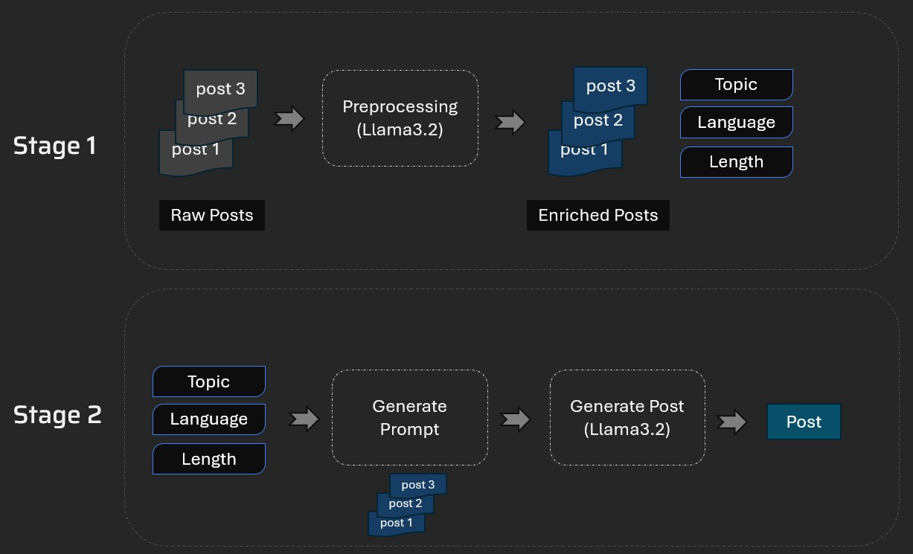

# LinkedIn Post Generator

An AI-powered LinkedIn writing assistant that generates draft posts from a selected topic, language, and length. It uses examples from a curated collection of past posts to guide the language model toward a more consistent writing style.

> **Project background:** This repository is based on the Codebasics LinkedIn post generator project. Review the source project's license and attribution terms before redistributing or using the project commercially.

## Overview

Writing consistently on LinkedIn takes time. This app helps reduce the blank-page problem by letting a user choose a topic, preferred language, and target length, then generate a draft using a Groq-hosted language model.

## Features

- **Topic selection:** Topics are loaded from tags in `data/processed_posts.json`.
- **Language selection:** English or Hinglish (Hindi-English mix).
- **Length selection:** Short, Medium, or Long.
- **Example-guided generation:** Retrieves matching posts by topic, language, and length and includes up to two examples in the prompt.
- **Simple interface:** A Streamlit UI with dropdowns and a Generate button.
- **Post metadata extraction:** A preprocessing script uses an LLM to extract line count, language, and up to two tags from each raw post, then normalizes similar tags.

## Demo and architecture

### Application interface



### Technical architecture



## How it works

The project has two main stages:

1. **Prepare the post dataset**
   - Read source posts from `data/raw_posts.json`.
   - Use an LLM to extract metadata: line count, language, and tags.
   - Normalize similar tags into a shared set of topics.
   - Save enriched records to `data/processed_posts.json`.

2. **Generate a new post**
   - The Streamlit UI loads available topics from the processed dataset.
   - The user selects a topic, length, and language.
   - The app filters historical examples using those selections.
   - Up to two matching examples are added to a prompt.
   - The prompt is sent to the configured Groq chat model, and the generated draft is displayed.

### Generation flow

```text
Raw LinkedIn posts
       |
       v
preprocess.py  --> extract metadata and normalize tags
       |
       v
data/processed_posts.json
       |
       v
Streamlit UI: topic + language + length
       |
       v
few_shot.py --> retrieve up to two matching examples
       |
       v
post_generator.py --> build prompt
       |
       v
llm_helper.py --> Groq-hosted chat model
       |
       v
Generated LinkedIn draft
```

## Tech stack

- **Language:** Python
- **UI:** Streamlit
- **LLM integration:** LangChain and `langchain-groq`
- **Model provider:** Groq
- **Data processing:** Pandas and JSON
- **Configuration:** Environment variables loaded with `python-dotenv`

## Project structure

```text
.
├── data/
│   ├── raw_posts.json
│   └── processed_posts.json
├── resources/
│   ├── architecture.jpg
│   └── tool.jpg
├── few_shot.py          # Loads posts and filters examples
├── llm_helper.py        # Configures the Groq chat model
├── main.py              # Streamlit interface
├── post_generator.py    # Builds prompts and generates drafts
├── preprocess.py        # Extracts metadata and normalizes tags
├── requirements.txt
└── .gitignore
```

## Getting started

### 1. Prerequisites

- Python 3.10 or newer is recommended.
- A Groq API key from the [Groq Console](https://console.groq.com/keys).

### 2. Clone the repository

```bash
git clone https://github.com/A-verse/Linkedin-Post-Generator.git
cd Linkedin-Post-Generator
```

### 3. Create and activate a virtual environment

**Windows PowerShell**

```powershell
python -m venv .venv
.\.venv\Scripts\Activate.ps1
```

**macOS / Linux**

```bash
python3 -m venv .venv
source .venv/bin/activate
```

### 4. Install dependencies

```bash
python -m pip install --upgrade pip
pip install -r requirements.txt
```

The code imports `python-dotenv`. If it is not installed by the current requirements, install it with `pip install python-dotenv` and add it to `requirements.txt` so that setup is reproducible.

### 5. Configure the API key

Create a file named `.env` in the project root:

```dotenv
GROQ_API_KEY=your_groq_api_key_here
```

Keep `.env` private. Do not commit API keys to GitHub.

### 6. Run the app

```bash
streamlit run main.py
```

Streamlit will print a local URL in the terminal. Open that URL in your browser.

## Re-process the source posts

If you change `data/raw_posts.json` and want to regenerate the enriched dataset, run:

```bash
python preprocess.py
```

The preprocessing script writes to `data/processed_posts.json`. It requires a working Groq API key and valid JSON input.

## Configuration

The model is configured in `llm_helper.py`. The current code uses the model identifier `openai/gpt-oss-120b` through `langchain-groq`. Model availability and provider naming can change, so verify the identifier in your Groq account if requests fail.

## Current limitations

- The app generates a draft; it does not publish directly to LinkedIn.
- Topic options depend on tags in the processed dataset.
- Example retrieval is a simple filter on topic, language, and length, not a vector database or semantic search system.
- The generation prompt includes at most two matching examples.
- The app currently has no automated test suite, user authentication, persistent generation history, or deployment configuration.

## Responsible use

- Review and edit generated content before posting.
- Do not upload private or confidential posts without permission.
- Check generated claims for accuracy and avoid presenting generated text as someone's exact words without consent.
- Keep API credentials in environment variables and never commit them.

## Potential improvements

- Validate API-key configuration and provide user-friendly error messages.
- Add unit tests for length categorization, filtering, and prompt construction.
- Improve example selection when no exact topic/language/length match exists.
- Add loading states, generation error handling, and a copy-to-clipboard action.
- Add an evaluation set to compare output relevance, style consistency, and length compliance.
- Add deployment instructions once a deployment target is selected.

## Credits & Acknowledgements

This project explores AI-powered content generation using Python, LangChain, and Groq, building on ideas demonstrated in the Codebasics LinkedIn Post Generator.

Created as a learning project focused on prompt engineering, few-shot prompting, and LLM integration.

Please review the original project's license and applicable usage terms before redistributing or using the code commercially.

---

<p align="center">
  ⭐ <b>Don't forget to star my repositories if you find them useful!</b>
  <br><br>
  Made by <b>Anjali Kamal</b>
</p>
